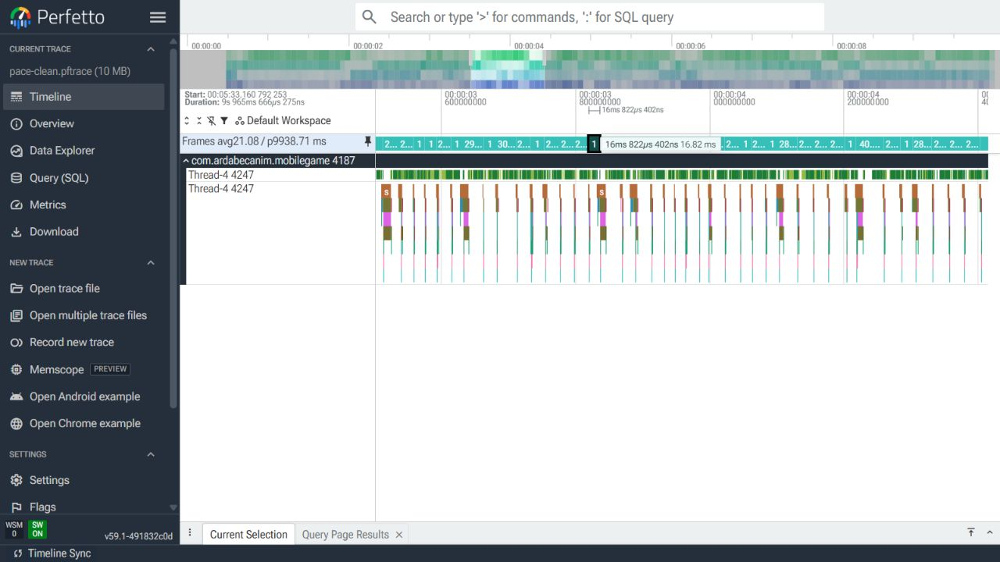

# Week 11 Lab A — prepared exit ticket (not posted)

Average **21.08 ms**, p99 **38.71 ms**, maximum **51.18 ms** over 449 app swap intervals. Signed release 0.9.1 / 7, build efb9acb7, Wave 3, High / Balanced / render scale 1.0. Pixel 8 Android Emulator, Android 16 API 36; ARM64 IL2CPP translated in an x86-64 guest. No screenshot/input automation during recording. This is submission cadence derived from eglSwapBuffers timestamps, not a native Android app FrameTimeline or physical thermal result. CPU-frequency data is unavailable. The selected active Development frame spends 25.02 ms inside FinishFrameRendering, including 2.60 ms of UI overlay rendering; investigate rendering and frame waits next.

The emulator shares host resources; do not treat these numbers as a phone benchmark. [Full report and reproducible data](perfetto-2026-11-23.md). Moodle submission remains excluded from the automated work.
