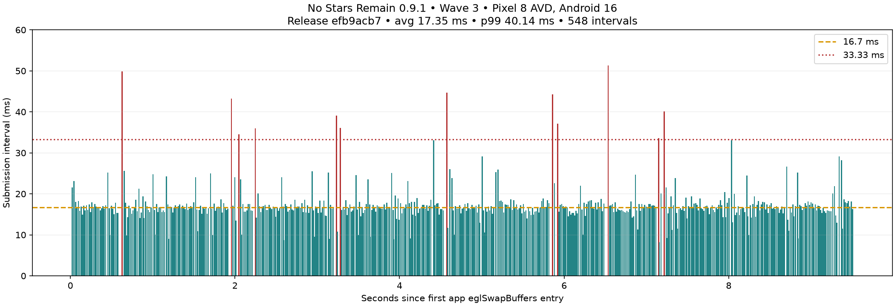
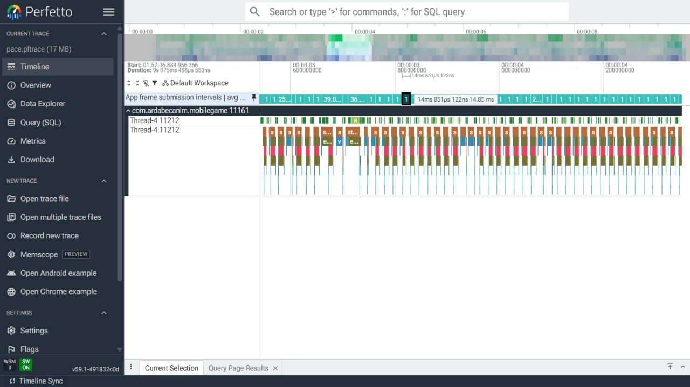
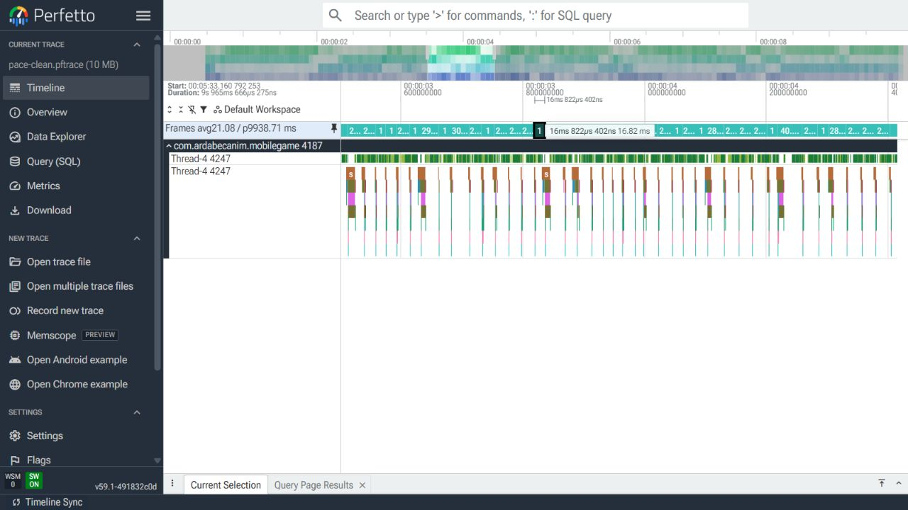
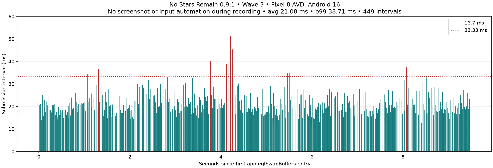

# Week 11 Lab A — release pacing trace

Captured **25 November 2026** (the filename follows the 23 November lab sheet). Signed release **0.9.1 / 7, efb9acb7**, source checkpoint 2aa8675. Pixel 8 AVD, Android 16 / API 36, x86-64 guest running ARM64 IL2CPP through translation. High tier, Balanced target 60 FPS, render scale 1.0. Background Unity builds had finished before recording. This is an emulator measurement, not a physical thermal soak.

## Capture and data quality

A normal run reached Wave 3 using drag input and real kill-based upgrades. No synthetic kills, invulnerability or enemies were inserted into this release run. [Start](heavy-release-start.png) and [end](heavy-release-end.png) screenshots identify the run. The 10-second trace is [pace.pftrace](pace.pftrace), captured with [this config](pace-config.pbtxt). The config was sent to `adb shell perfetto --txt -c - -o /data/misc/perfetto-traces/pace.pftrace` over stdin; reading a config from /data/local/tmp was denied by Android SELinux. The failed attempt produced no accepted measurement.

Perfetto v59.1 trace_processor found no nonzero error/data-loss stats. **There is no app SurfaceFrame timeline in this trace**. SurfaceFlinger has 563 display-frame entries, whose durations measure compositor work rather than Unity frame time. Those durations are not used as game frame times.

Instead, the app's Thread-4 / TID 11212 contains 549 `eglSwapBuffers` slices. [SQL](egl-swaps.sql), [export](egl-swaps.csv) and [summary](pacing-summary.json) provide the calculation. Consecutive entry timestamps produce 548 app submission intervals across 9.5065 seconds. These measure submission cadence, not confirmed presentation times or isolated CPU/GPU execution.

**Average: 17.35 ms. p99: 40.14 ms** (nearest-rank percentile). Maximum 51.30 ms. 268/548 intervals exceed the lab's literal 16.7 ms threshold: **48.91%**. Tiny variations around a 60 Hz interval inflate that strict threshold; this percentage is not Android's FrameTimeline jank classification. A more informative tail count is **12/548 (2.19%) above 33.33 ms**. No paused or loading interval is intentionally included in this release trace.

The plot above is a local reconstruction from the recorded timestamps. With owner permission on 25 November, opened the actual trace in Perfetto UI and added a SQL-derived slice track using the same consecutive eglSwapBuffers entry timestamps. Filtered the timeline to the app render thread (TID 11212).

**Full-recording average 17.35 ms; p99 40.14 ms.** The screenshot shows a zoomed detail; the figures refer to all 548 intervals. The added debug track is explicitly derived from real swap events, not a native Android SurfaceFrame timeline. The screenshot is unretouched browser output.

## Measurement observer effect

Review found eight `screencap` processes during this recording. [Overlap SQL](screenshot-overlap.sql) separates intervals overlapping their observed scheduling spans: **102 overlapping intervals averaged 19.351 ms; 446 non-overlapping intervals averaged 16.889 ms**. **10 of the 12 intervals >33.33 ms overlap screencap**, while 2 do not. This is correlation, not proof that readback caused every spike. Do not use 40.14 ms as a clean gameplay-only baseline. A new release recording without screenshot or input automation during the ten-second window follows below.

## CPU frequency and comparison

No CPU-frequency counter track is present on this emulator. Frequency events were requested, but the virtual device did not supply them. There is no evidence here for either physical throttling or sustained thermal stability. The AP overlay reading is not a measured phone temperature.

Week 3's worst-case baseline was average 17.72 ms / p99 33.33 ms, in an older game with a different presentation-sampling method. The original 40.14 ms tail includes measurement interference and is not a clean new baseline or a controlled regression against Week 3. Week 7's emulator soak likewise does not establish phone thermals. The Lab B candidate is the **12 intervals over 33.33 ms**; its cause still needs an attributable CPU/GPU capture.

References: [official Android recording guide](https://perfetto.dev/docs/getting-started/local-android-trace-recording), [FrameTimeline](https://perfetto.dev/docs/data-sources/frametimeline).

## Clean repeat — preferred pacing measurement

After restarting the AVD with **host GPU**, recorded [pace-clean.pftrace](pace-clean.pftrace) on the same signed release efb9acb7, High / Balanced / scale 1.0. Headless auto GPU had selected SwiftShader and could not initialize the game; that failed startup produced no accepted measurement. [Successful backend](clean-emulator-gpu.txt) matches the NVIDIA OpenGL ES Translator used earlier.

The normal run reached Wave 3 and selected a genuine level-up before capture. [Before](clean-heavy-start.png): 00:36 remaining, Lv 6, 55 kills. [After](clean-heavy-end.png): 00:22 remaining, Lv 6, 68 kills. The outside screenshots bracket the settling time, ten-second trace and file pull, so they are not an exact ten-second timer pair. No level choice, loading or background interval occurred inside the recorded gameplay window. The player was left stationary during recording; automatic weapons remained active. No synthetic fixture was used in this release.

**Zero screencap processes** and no nonzero error/data-loss stats appear in the [quality checks](clean-trace-quality.txt). No screenshot, Logcat polling or injected input ran during the ten-second capture. [CSV](clean-egl-swaps.csv) contains 450 swap entries / **449 intervals** over 9.4649 s. Recompute with `python docs/CA3/perf/analyse-swaps.py --csv clean-egl-swaps.csv --output clean-pacing-summary.json`.

**Average 21.08 ms; p99 38.71 ms; maximum 51.18 ms.** 11/449 intervals exceed 33.33 ms (**2.45%**). The literal >16.7 ms fraction is 374/449 (**83.30%**), not Android's FrameTimeline jank label. This is still app submission cadence, not display presentation time or GPU execution time.

The new average is worse while p99 is slightly lower than in the screenshot-driven run. Removing screenshot automation did not eliminate long frames, and this is **not a controlled A/B performance improvement**: different run, upgrades, cold boot and uncontrolled host load apply. A host game was visibly running during the follow-up inspection; its exact load during the trace was not captured. Do not attribute a game-code regression or GPU limit from these two runs. Use the clean repeat as the emulator pacing evidence and retain the first recording to show the measurement confound.
